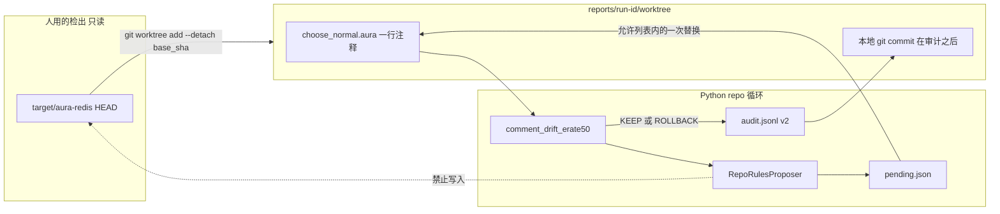
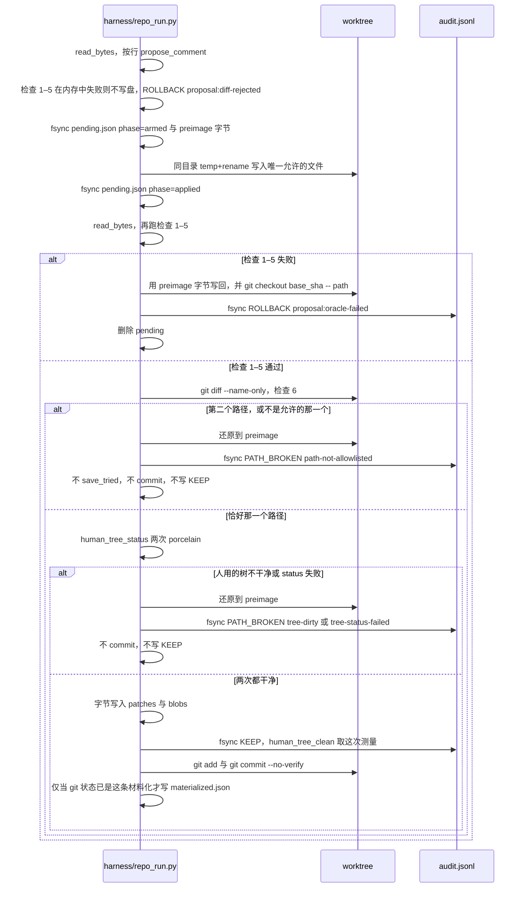

# Aura Maintainer 仓库维护循环：在 worktree 里修一条合同漂移

| 字段 | 值 |
| --- | --- |
| 文档 | Aura Maintainer repo-mode design |
| 落点 | 实现时写成 `docs/design-repo.md`。不替换 `docs/design.md` |
| 作者 | Aura Maintainer |
| 日期 | 2026-10-16 |
| 状态 | Draft |
| 目标仓库 | `/home/dev/code/grok-dev/aura-maintainer` |
| 被维护的树 | `target/aura-redis`（子模块，Aura 语言项目）。不是 `/home/dev/code/aura` |
| 运行时钉扎 | `target/aura-redis/AURA_REF` = `b0c6b3555e4287c8807b019a8b9316ee94c988b6` |
| 观察时的子模块 HEAD | `e8840d7cbdb5a55e4f3a7d5d81a792d7f58edb5a`（协议记录运行时读到的 sha，不把这个字面量当唯一合法基线） |
| 实现语言 | 设计说明为中文；路径、标识符、API、代码、PR 标题保持英文 |

## Overview

v1（`docs/design.md`）已经能对 **workspace 里的一个** `choose-fn` 做 `snapshot → mutate:rebind → fixture → keep/rollback`。Python 拥有外层循环（`harness/run.py` 的 `main`），每个 Aura 进程只跑一个 cycle，KEEP 只改 `reports/<run-id>/champion.body`。`target/aura-redis` 的已跟踪源文件保持干净。这是一条已验证的回归门，本文不改它的 KEEP 规则、不改它的审计 schema、也不把 `mutate:replace-pattern` 打开。

它维护的不是仓库。`harness/discover.py` 的 `discover()` 会发出三条 `propose: false` 的合同漂移，但没有任何路径把补丁写进被跟踪文件。`mutate:rebind` 只重绑本进程 workspace 里名为 `choose-fn` 的定义，不会改 `choose_*.aura`。进程一退出，workspace 就没了。

本文定义后继模式 `--mode repo`。一个 cycle 在 **维护者拥有的 git worktree** 里发现一个已跟踪源文件上的具体问题，做一处外科编辑，跑一个「改之前失败、改之后通过」的检查，然后要么把结果 KEEP 到 `reports/<run-id>/`（补丁文件 + worktree 内的本地提交），要么把该 worktree 的跟踪字节 ROLLBACK 回本 cycle 开始前的内容。人正在用的子模块检出不写、不提交、不推送。崩溃若发生在把文件改脏之后、审计行 fsync 之前，resume 按记录的 base git sha 把 worktree 还原，并且不写 KEEP。已经 fsync 的 KEEP 不会被再放一遍。

里程碑只落地一个问题类：`comment-drift:choose_normal:erate-50`。`choose_normal.aura` 第 11 行注释声称 `erate ≥ 50 → noop|flat`，导出的 `*policy-choose-normal*` 字符串里没有这个分支。闭集替换这一行注释。策略字符串的 sha256 必须不变。预期一次运行是 **2 个 cycle**（1 次 KEEP，1 次 IDLE），不是数千次。不调用 MiniMax，不要求 24 小时 soak。

## Background & Motivation

### v1 已经钉死的事实

这些行为有测试和跑过的报告，repo 模式不得把它们改弱：

- 外层循环在 `harness/run.py`。`ast:snapshot` 的 id 是进程内下标，不是 resume 指针。`--resume` 复用同一个 run 目录，从 `next_cycle_id` 继续。崩溃且还没打出完整 `CYCLE_JSON` 时不更新 champion。
- 变异只允许 `(mutate:rebind "choose-fn" body summary)`，而且只有返回值 **等于** `#t` 才进入 trial。不写 `choose_*.aura`，不调用 `hot-strategy:swap!`。`agent/maintainer.aura` 的注释禁止调用 `ast:rollback`、`hot-strategy:swap!`、`workspace:rollback-to`、`workspace:rollback-latest`。`docs/design.md` 写明钉扎上没有 `ast:rollback`，回滚是 `(ast:restore id)` 再裸调用 `(eval-current)`，因为 `ast:restore` 只拷回 `FlatAST`，不重绑 `top_env`。本仓库没有编译器树，这个「不存在」是从 v1 规格继承的，不是这次重新对 `AURA_REF` 做的审计。
- `docs/design.md` 同时写明钉扎上有 `mutate:replace-pattern`、`mutate:set-body`、`mutate:rename-symbol`、`mutate:atomic-batch`。v1 禁止它们：它们会扫描整个 workspace，能改到代理自己的代码。本文不把这些名字再对一遍 pin。里程碑的 Aura 进程数是 0，隔离不依赖它们在二进制里是否真的注册。repo 模式不允许「把这几个原语打开」来充当写文件。
- `policy_agent.aura` 是 3197 行。`set-code` 在第 1855 行。文件头第 8–9 行写的是 `c-func` 与用户闭包不能放在同一个 workspace。`eval-current` 会重入当前文件，写在启动栅栏第 104–112 行，不在文件头。v1 不把这个文件整份 `set-code`。`adaptive.aura` 第 14–16 行是同一条 `c-func` 限制。数据面不在变异路径上。
- KEEP 是训练夹具分严格上升，或训练分不降且留出集属性分上升。属性分下降是 `proposal:fitness-drop`。已匹配行被改掉是 `proposal:matched-row-changed`（`soft22` 仍是 `proposal:soft-regressed`）。`choose_broken` 永不 KEEP。金标准是未修改 `choose_normal` 在钉扎二进制上的输出，不是 Redis hit%。
- Champion 字节只在审计行 fsync 之后才原子替换。schema 是 `aura-maintainer.audit.v1`。字段变了必须用新 schema，不得往 v1 对象里塞仓库字段。
- 连续三次 `PATH_BROKEN` 停跑，退出码 3。`proposal:` 开头的 `ROLLBACK` 和 `PROBE_FAIL` 把连续计数清零。跑完时审计里仍有任何 `PATH_BROKEN` 也是退出码 3。实现是 `harness/audit.py` 的 `next_streak` 与 `exit_code_for`，阈值 `STREAK_LIMIT = 3`。
- 默认提议者是规则闭集。`--proposer llm` 才导入 `harness/proposers/llm.py`，调用时才读 `~/code/keys/minimax`。本里程碑不设计 24 小时 MiniMax soak，也不把 LLM 放上默认路径。
- `discover()` 发出三条说明性漂移，`propose` 都是 false，由 `harness/test_catalog.py` 的 `DiscoverTests.test_drift_issues_are_not_proposals` 锁住：
  - `contract-drift:test_hot_strategy_policy`
  - `comment-drift:choose_normal:erate-50`
  - `doc-drift:policy-readme-hot-cold`
- 每个 cycle 结束 `tree_dirty()` 在 `target/aura-redis` 上跑 `git status --porcelain`。已跟踪文件出现 `M` 或 `D` 则 `PATH_BROKEN` `reason=tree-dirty`，并且停跑。`??` 被忽略。`git` 失败时 v1 把结果当成「不脏」（`returncode != 0` 或 `OSError` 都返回 `False`）。repo 模式不得沿用这个「失败即干净」。

### 被维护的文件里，里程碑要动的那一行

`target/aura-redis/src/redis/policy/choose_normal.aura` 第 11 行（文件里 `noop|flat` 的唯一一次出现）：

```text
;   Prefer ttl_aware when TTL pressure, else lru|flat; if rate ≥ 50 → noop|flat
```

同文件第 34–37 行的 `cond` 才是合同：`((>= erate 20)` 时，有 TTL 压力返回 `ttl_aware|flat|soft`，否则返回 `lru|flat|soft`。没有 `erate` 50 的分支，也没有 `noop|flat`。`discover()` 的判定就是这三件事同时成立（`harness/discover.py` 第 108–116 行）：源文件含 `noop|flat`，抽出的 body 不含 `noop|flat`，body 也不含 `(>= erate 50)`。

`extract_policy_string`（`harness/catalog.py`）只解码 `(define *policy-choose-normal* "...")` 里面的字面量。注释在字符串外。`test_extract_ignores_comment_outside_string` 已经锁住「注释里的 `SOFT_BUDGET` 不会进 body」。所以改第 11 行不会、也不允许改变导出字符串。`template` 的签名是 `template(normal, min_ops, miss_pin, soft_budget)`。`test_template_gold_matches_file_bytes` 调用的是 `template(self.catalog.normal, 40, 30, 20)`，第一个参数是抽出的 body，不是三个整数。那次调用的结果与抽出的 normal 字节相同。里程碑开始时没有一份「该写回文件」的 champion 差异。

### 为什么不把另外两类漂移当里程碑

`doc-drift:policy-readme-hot-cold` 把两个文件合成一条 issue：`src/redis/policy/README.md` 第 16、23 行和 `docs/workloads.md` 第 26 行仍写 `lfu|hot_cold`，而 `choose_normal` 的对应分支是 `lfu|flat`。一个 cycle 只能改一个文件。并且 `lfu|hot_cold` 在 `choose_conservative.aura` 第 25、28 行和 `choose_inverted.aura` 第 14 行是真实返回值。把所有 `lfu|hot_cold` 删掉会改错保守策略和反转探针的文档。这一类要先按文件拆开、再逐句对照 body，不进本里程碑。

`contract-drift:test_hot_strategy_policy` 是 `tests/test_hot_strategy_policy.aura`。第 17 行 `set-code` 的 stub 只有 4 个形参。第 25–27 行调用 `(choose-fn 10 100 5 5)` 并期望 `"lfu"`。第 29–31 行是另一次调用 `(choose-fn 500 10 480 20)`，期望 `"lru"`，不是同一次 4 参调用的两个期望。文件还调用 `hot-strategy:swap!`。v1 明确不改测试来修绿。把断言改弱可以让「检查变绿」，但那不是修复。把它改成 9 参并真正执行，会碰到本钉扎上不可信任的 `swap!` 布尔值。本里程碑不动 `tests/**`。

把 v1 champion body 写回某个 `choose_*.aura` 也不是本里程碑。gold 字节已经在文件里。写一份不同的 body 会改变产品策略字符串，oracle 不再是「注释与 body 一致」，而是「文件里的 lambda 在夹具上得分」。那是下一种问题类，等 worktree 协议落地之后再单独立项。

### 痛点

要称为「维护一个仓库」，cycle 必须同时做到五件事：在被跟踪源里发现一个具体问题；提议对源文件的一处外科修改，而不是只改 RAM 里的 lambda；应用之后有一个改前失败、改后通过的检查，或一个给这次修改打分的检查；KEEP 把字节和审计留在磁盘上，ROLLBACK 让被维护的树回到 cycle 开始前的字节；apply 与审计 fsync 之间崩溃时，resume 既不留下半截树，也不重放已经提交的 KEEP。v1 做了后半段的审计和 champion，没有做前半段的磁盘树。

## Goals & Non-Goals

### Goals（本里程碑必须交付）

1. 新文档是 `docs/design-repo.md`。新模式是 `--mode repo`。`docs/design.md` 仍是 v1 规格。`--mode hold` 与 `--mode recover` 的行为、默认值、审计 schema 不变。
2. 一个 cycle 只绑定一个 issue、一个 proposal、一个文件。里程碑的文件是 `src/redis/policy/choose_normal.aura`，编辑是唯一一行注释，不改 `(define *policy-choose-normal* ...)`。
3. 闭集规则产生这行替换。不读 `~/code/keys/minimax`，不导入 `harness/proposers/llm.py`。
4. 应用发生在 `reports/<run-id>/worktree`，用 Python 写文件加 git，不用 `mutate:rebind`。人用的 `target/aura-redis` 检出在 KEEP 的 fsync **之前**再测一次 porcelain；测失败就不写 KEEP。HEAD 不变。
5. Oracle 在改之前失败、改之后通过，并且比「文件变了」更强：漂移谓词翻转，导出 body 的 sha256 不变，diff 恰好是这一行，新行写明真实的软门返回值。
6. 提交点是一条 fsync 过的 `aura-maintainer.audit.v2`。KEEP 的补丁落在 `reports/<run-id>/patches/`。worktree 里的 `git commit` 发生在这次 fsync 之后，不推送，不更新父仓库的 gitlink。
7. apply 之后、审计 fsync 之前死亡：resume 复用已经注册的 worktree，把该路径还原到 preimage，审计里不出现这次 KEEP。审计里已经有 KEEP：文件留在该 KEEP 的 `after_sha256`，不因为后面还有一条 IDLE 就 `checkout` 回 `base_sha`，也不再写第二条 KEEP。已经 fsync 的 IDLE 没有 preimage，不是还原目标。该 cycle 已有完整的一行：不追加第二条决定。
8. 磁盘路径上的 `PATH_BROKEN` 仍走 `next_streak` / `exit_code_for`。连续三次停，退出码 3。跑完时审计里仍有任何 `PATH_BROKEN` 也是退出码 3，即使 `--cycles` 先把循环截住。预算截住本身不是 `stopped_early`。`proposal:` ROLLBACK 清零。
9. 预期量级：这条问题类的闭集大小是 1。`--cycles` 默认 2。一次成功运行是 1 条 KEEP 加 1 条 IDLE。worktree 工作区大约 1.8MB。对象库在 `.git/modules/target/aura-redis`（约 952KB），pack 文件是 802456 字节（约 784KiB），与子模块共用，不另复制一份。不启动 Aura 进程。

### Non-Goals（本里程碑明确不做）

- 不替换、不删改 `docs/design.md` 里的 v1 循环。不把 `--mode` 的默认值从 `hold` 改成 `repo`。
- 不改 C 数据面：`target/aura-redis/native/**`、任何 `.c` / `.h` / `.so`、RESP、`server_ffi.aura`。不编辑 `/home/dev/code/aura`。
- 不改 `adaptive.aura`、`adaptive_body.aura`、`commands.aura`、`resp.aura`、`store.aura`。不把 `policy_agent.aura` 整文件 `set-code`。
- 不调用 `hot-strategy:swap!`，不调用不存在的 `ast:rollback`，不调用 `workspace:rollback-to` / `workspace:rollback-latest`。
- 不启用 `mutate:replace-pattern`、`mutate:set-body`、`mutate:rename-symbol`、`mutate:atomic-batch`。隔离方式是「磁盘补丁在代理 workspace 之外」，不是「另开一个 workspace 再把全树扫一遍」。
- 不改 `tests/**` 来修绿，包括 `tests/test_hot_strategy_policy.aura`。
- 不改 `src/redis/policy/README.md` 和 `docs/workloads.md`。不把 `lfu|hot_cold` 从保守策略或 inverted 的文档里删掉。
- 不把 champion body 写回 `choose_*.aura`。不把夹具分说成 hit%、regret 或覆盖率。
- 不自动 `git push`，不在父仓库里提交子模块 gitlink，不把 `reports/**` 重新放进 git 跟踪（`.gitignore` 已忽略 `reports/**`，只保留 `reports/.gitkeep`）。
- 不跑 24 小时 soak，不把 LLM 仓库提议者放进本里程碑。`--hours` 在 repo 模式里只做上限检查（`> 72` 仍 exit 2），目录空了就退出，不进入 v1 的 `idle_wait`。
- 不扫描任意 `.aura` 找 TODO/FIXME，不给 23 个已跟踪 `.aura` 文件各发明一个 issue。允许列表在本里程碑只有一个相对路径。

## Proposed Design

### 4.1 组件与信任边界



**谁拥有循环。** 仍是 Python。`--mode repo` 在 `harness/run.py` 的 `main` 里、在 `find_aura_bin()` 之前分叉到 `harness/repo_run.py` 的 `main`。该模块不导入 `harness.proposers.llm`，不调用 `spawn_cycle`，不 `require` `agent/maintainer.aura`。Aura 不是这条里程碑的执行器：要改的字节在磁盘注释里，`query:*` 看不见字符串外面的注释，`mutate:rebind` 也写不回文件。

**谁可以写。** 只允许写两类路径：

- `reports/<run-id>/**`（审计、pending、补丁、worktree）。
- worktree 里面、解析之后恰好等于 `src/redis/policy/choose_normal.aura` 的那个普通文件。

禁止写 `target/aura-redis/**`。禁止写 worktree 里的其它路径。符号链接拒绝：目标路径或它的任一父目录是符号链接时，`PATH_BROKEN` `reason=symlink-refused`，不跟随。

**v1 的 discover 继续看人用的检出。** `load_catalog()` 和 `discover()` 的路径是 `root / "target" / "aura-redis" / ...`。repo 模式不把 `Catalog.root` 指到 worktree，否则以后一旦写 body，v1 的目录会跟着变。里程碑用同一个谓词函数，但读的是 `worktree / "src/redis/policy/choose_normal.aura"`。因此一次成功的 KEEP 之后，`DiscoverTests.test_drift_issues_are_not_proposals` 仍然能在人用的检出上看到 `comment-drift:choose_normal:erate-50`，并且 `propose` 仍是 false。这是「没有改脏产品树」的回归绊线。

### 4.2 Worktree 与 base sha

子模块的 gitdir 是文件不是目录：`target/aura-redis/.git` 内容为 `gitdir: ../../.git/modules/target/aura-redis`。`git worktree add` 的注册信息写进这个 gitdir 的 `worktrees/`，不改变主 worktree 的 HEAD，也不应该改变父仓库看到的 gitlink。`git worktree add` 在路径已经注册时会非 0。因此 **第一次运行** 和 **`--resume`** 不是同一段启动。

cwd 规则：`rev-parse HEAD` 和 `worktree add` 的 cwd 是源仓库 `target/aura-redis`（worktree 这时还不存在）。`show`、`add`、`commit`、`checkout`、`diff` 的 cwd 是 worktree。源仓库上禁止跑 `add` / `commit` / `checkout`。全程 argv 数组，`shell=False`。

本里程碑不调用 `git worktree prune`，也没有第二条应用表面。不使用 `git clone --shared`。`worktree add` 之后若人用检出或父仓库 gitlink 变脏：只对该路径 `git worktree remove --force`，记 `PATH_BROKEN` `tree-dirty`，停。不换一种克隆方式继续。

#### 第一次运行（没有 `--resume`）

1. `human_tree_status()`（见下）。不干净或命令失败：不创建 worktree。审计还是空的，可以写一条 v2 `PATH_BROKEN`（`tree-dirty` 或 `tree-status-failed`），立刻 exit 3。不修改 `tree_dirty()`，v1 的 `_finish_cycle` 继续用它。
2. `git -C target/aura-redis rev-parse HEAD` 得到 `base_sha`。`git -C target/aura-redis cat-file -t <base_sha>` 必须是 `commit`。对象不在库里：`PATH_BROKEN` `reason=resume-missing-base`，exit 3。
3. 只有这条路径 **还没** 在 `git worktree list` 里时才 `git -C target/aura-redis worktree add --detach <abs reports/run-id/worktree> <base_sha>`。目标必须在 `reports/<run-id>/` 下，不得在 `target/aura-redis/` 里面。命令失败：`PATH_BROKEN` `reason=worktree-create-failed`，不碰人用的检出。这次失败可以写入审计，因为还没有任何 KEEP 或 ROLLBACK。
4. 立刻再跑一次 `human_tree_status()`。变脏则 `worktree remove --force` 这一条路径，`PATH_BROKEN` `tree-dirty`，停。没有克隆退路。
5. fsync `reports/<run-id>/base.json`（schema `aura-maintainer.repo-base.v1`）：

```json
{
  "schema": "aura-maintainer.repo-base.v1",
  "git_sha": "<base_sha>",
  "worktree": "<absolute path>",
  "human_checkout": "target/aura-redis",
  "path": "src/redis/policy/choose_normal.aura"
}
```

6. 用二进制读 worktree 里的目标文件，与 `git -C <worktree> show <base_sha>:src/redis/policy/choose_normal.aura` 的原始字节比较。不一致则还没有写提案，拆掉这次新建的 worktree，`PATH_BROKEN` `reason=base-mismatch`。

#### `--resume`（禁止再 `worktree add` 到已注册路径）

先做 4.6 的模式检查（exit 2 时不写审计）。然后只跑 reconcile，不把「路径已注册」当成 `worktree-create-failed`。

1. 读已有的 `base.json`。缺 schema、缺 `git_sha`、或 sha 不是 commit 对象：若审计里已经有 KEEP、ROLLBACK 或 IDLE，**不追加**任何行，stderr 说明 `resume-missing-base`，exit 3。若审计里还没有这三种决定，才允许追加一条 v2 `PATH_BROKEN` `resume-missing-base`。
2. 注册与否用绝对路径比较，不用相对路径做子串匹配。`git worktree list --porcelain` 的 `worktree` 行是绝对路径，`base.json` 的 `worktree` 也是。两边都 `Path.resolve()` 之后相等才算已注册。对上了：复用，禁止再 `worktree add`。相对的 `reports/<run-id>/worktree` 对不上这条绝对路径时，不得因此当成没注册。
3. 目录不存在、也没注册：`git worktree add --detach` 到 `base.json` 的 sha。已有 KEEP、ROLLBACK 或 IDLE 时，补建失败不得追加审计行（包括不得追加 `worktree-create-failed`），exit 3，审计字节不变。已有 KEEP 且注册还在：复用，按 4.6 把文件放到该 KEEP 的 `after_sha256` 并材料化，不 `checkout` `base_sha`。
   目录存在、但没注册：禁止对这个非空目录直接 `worktree add`。目标已经存在且非空时，这条命令失败。目录还没注册，`git worktree remove --force` 也不是正确工具。只删除 `base.json` 里那个已经 `resolve()` 的路径，而且它必须落在 `reports/<run-id>/` 之下；落在外面就拒绝，什么都不删。删掉之后再 `worktree add --detach`。已有 KEEP、ROLLBACK 或 IDLE 时，删除或 add 失败都 exit 3，审计字节不变。还没有这三种决定时，删掉之后 add 仍失败，才可以写 `worktree-create-failed`。不要全局 `git worktree prune`。
4. worktree 已在、`base.json` 还没有、审计也没有、`pending.json` 也没有：这是 `worktree add` 成功之后、`base.json` fsync 之前死亡。若 worktree 的 `rev-parse HEAD` 等于人用检出的 HEAD，目标文件字节等于 `git show HEAD:path`，并且 `human_tree_status()` 干净，就补写 `base.json`，然后当作还没开始的 cycle 1。对不上：`worktree remove --force` 这一条路径，追加一条 `PATH_BROKEN` `resume-missing-base`（此时还没有 KEEP），exit 3。
5. 有 `base.json`、worktree 已在、没有 pending、审计是空的、文件字节等于 base：不要再建 worktree，不要写 `worktree-create-failed`。直接进入 cycle 1。PR5 要覆盖这次启动。

`human_tree_status()` 同时跑两条命令，任一失败或任一条已跟踪变更都算不干净：

- 父仓库：`git status --porcelain -- target/aura-redis`，cwd 是 aura-maintainer 根。
- 子模块：与 `tree_dirty()` 相同的已跟踪 `M`/`D` 判断，但 `returncode != 0` 或 `OSError` 是 `tree-status-failed`，不是干净。`??` 仍忽略。

### 4.3 问题类与闭集提议

从 `discover()` 抽出纯函数，行为与今天的三行条件相同。`discover()` 改为调用它，issue id 和 `propose: false` 不变：

```python
def comment_drift_erate50(source: str, body: str) -> bool:
    return (
        "noop|flat" in source
        and "noop|flat" not in body
        and "(>= erate 50)" not in body
    )
```

`body` 必须来自 `extract_policy_string(source, "normal")`。抽取抛错是路径损坏（`PATH_BROKEN` `reason=extract-failed`），不是「没有漂移」。

常量（UTF-8，旧行与文件第 11 行字节相同，含 `≥` 与 `→`）：

```python
OLD_LINE = (
    ";   Prefer ttl_aware when TTL pressure, else lru|flat; "
    "if rate ≥ 50 → noop|flat"
)
NEW_LINE = (
    ";   Prefer ttl_aware|flat|soft when TTL pressure, else "
    "lru|flat|soft. The soft gate is (>= erate 20); "
    "the body has no rate-50 branch."
)
```

`NEW_LINE` 故意不含子串 `noop|flat`。含了的话，v1 谓词在改完之后仍为真，oracle 必须失败。也不把 `(>= erate 50)` 写进 body 来「骗过」谓词：body 的 sha256 守住这件事。

提议者 `harness/repo_catalog.py` 不调用 `replace_once`。`replace_once` 对「找不到」和「不唯一」都抛 `ValueError`，签名也不是按行替换。按行做一次 `splitlines(keepends=True)`：

```python
class ProposeOutcome(enum.Enum):
    ABSENT = "absent"
    NOT_UNIQUE = "not-unique"

def propose_comment(source: str) -> str | ProposeOutcome:
    lines = source.splitlines(keepends=True)
    hits = [i for i, line in enumerate(lines) if line.rstrip("\r\n") == OLD_LINE]
    if not hits:
        return ProposeOutcome.ABSENT
    if len(hits) != 1:
        return ProposeOutcome.NOT_UNIQUE
    i = hits[0]
    ending = "\r\n" if lines[i].endswith("\r\n") else ("\n" if lines[i].endswith("\n") else "")
    lines[i] = NEW_LINE + ending
    return "".join(lines)
```

- `ABSENT`：这个类没有提议。跳过它。注册表里每一个类都是 `ABSENT`，或 tried 里已经有键时，才 `IDLE` `reason=repo-catalog-empty`。不写文件。旧行还在，只是出现了不止一次，不是 `ABSENT`。
- `NOT_UNIQUE`：不写文件。本 cycle 的决定是 `ROLLBACK` `reason=proposal:pattern-not-unique`，审计 fsync 之后 `save_tried`。不要靠 `ValueError` 的文案来分类。它不是 `str`，也不是 `ABSENT`，不得改写成 `repo-catalog-empty`。不看注册表里后面的类。同一次运行不再开下一 cycle，所以审计里不会接着一条 IDLE。旧注释仍在文件里，目录并不空。
- 返回 `str`：这是候选的完整文件文本。不按行号硬编码失败。今天的树上匹配点是第 11 行，单元测试锁这个行号；行号漂移但旧行仍唯一时，替换仍然合法。换行留在被替换的那一行上，其它行的 `\n` 或 `\r\n` 不动。
- 提议 id 是 `comment:choose_normal:erate-50`，issue id 仍是 `comment-drift:choose_normal:erate-50`。两者不要合成一个字符串。
- oracle 第 4 条仍是后盾：即使提议者放行，行 diff 不是恰好这一行也不 KEEP。

扩展点是一个冻结的数据类，本里程碑只注册这一条。下一种问题类是再加一个实例，不是再开一个写文件入口：

```python
@dataclass(frozen=True)
class RepoClass:
    issue_id: str
    proposal_id: str
    path: str  # 相对 aura-redis 根，恰好一个文件

    def propose(self, source: str) -> str | ProposeOutcome:
        """ABSENT、NOT_UNIQUE，或整文件新文本。不得写盘。"""

    def oracle(self, before: str, after: str) -> bool:
        """改前必须为 False 的那条检查，改后必须为 True。"""
```

队列规则：按注册顺序看每个类，不要把「不是 `str`」一律当成空目录。`propose` 返回 `NOT_UNIQUE`：立刻结束这次运行，fsync `ROLLBACK` `proposal:pattern-not-unique`，再 `save_tried`，不写 IDLE。返回 `ABSENT`，或 `tried` 里已有 `proposal_id|preimage_sha256`：跳到下一个类。返回 `str` 且键还没有：这就是本 cycle 的候选，不再看后面的类。全部跳过才是 `IDLE` `reason=repo-catalog-empty`。键由 repo 代码自己拼，不调用 `harness/catalog.py` 的 `mark_tried` 或 `tried_key(..., once_per_run=True)`。那两个函数会丢掉 digest，存成 `proposal_id|*`（`tried_key` 第 324–327 行，`mark_tried` 第 464–467 行）。本里程碑注册表长度为 1。一个 cycle 不会同时拿出第二个 hunk。这张表上的 `NOT_UNIQUE` 仍然是 ROLLBACK，不是 `repo-catalog-empty`。

### 4.4 Oracle

名字：`oracle:comment-drift:erate-50`。

它不是夹具分。改注释之前 body 已经是 gold，夹具分改前改后都是 12，不能当作「改前失败」。失败的检查是漂移谓词。

KEEP 要同时满足检查 1–5 和检查 6。1–5 是提议，在内存中的 `before` / `after` 上做。6 是写盘之后的路径检查，不是提议失败，也不在「任一为假就 ROLLBACK」这句里面。

检查 1–5 任一为假：若还没写 worktree，直接 `ROLLBACK` `proposal:diff-rejected`；若已经写了，先还原再 `ROLLBACK` `proposal:oracle-failed`。这两条都算 `proposal:`，清掉 `PATH_BROKEN` 连续计数，不换 KEEP。

1. `comment_drift_erate50(before, extract_policy_string(before, "normal")[0])` 为真。
2. `comment_drift_erate50(after, extract_policy_string(after, "normal")[0])` 为假。
3. 两个 body 的 `sha256_bytes` 相等，且等于改前抽出的 body。这就是「没有改定义」。
4. `before` 与 `after` 的行序列等长，且恰好有一行不同，该行的改前内容去掉换行后等于 `OLD_LINE`，改后等于 `NEW_LINE`。
5. `after` 整文件不再包含 `noop|flat`。`NEW_LINE` 同时包含 `ttl_aware|flat|soft`、`lru|flat|soft`、`(>= erate 20)` 这三个子串。只删注释、不写真实软门，过不了第 5 条。
6. 只在写盘之后跑。相对 `base_sha` 的 `git diff --name-only` 恰好是 `src/redis/policy/choose_normal.aura`。出现第二个路径，或唯一路径不是这一条：先还原，然后 `PATH_BROKEN` `reason=path-not-allowlisted`。不 `save_tried`，不 commit，不清 `PATH_BROKEN` 连续计数。这是实现写越界，不是坏提议，不得记成 `proposal:oracle-failed`。`--dry-run` 不写盘，跳过第 6 条。

第 5 条里的第三个子串是 ASCII 的 `(>= erate 20)`，与 `NEW_LINE` 一致。不要写成 Unicode `≥`，否则和常量对不上。

`--dry-run` 只在内存里跑检查 1–5，不创建脏文件。一次调用只 fsync **一条** `ROLLBACK` `reason=proposal:dry-run`，然后停。`--cycles` 省略时默认是 2，这次调用仍然不进入第二个 cycle，不写第二条 `proposal:dry-run`，也不写 IDLE。不启动 Aura。这条 ROLLBACK **不** 调用 `save_tried`，也不计入 `--cycles` 的维护预算。键不写入。文件字节不变。之后对同一个 run-id **不带** `--dry-run` 的 `--resume` 仍可以 KEEP。再带 `--dry-run` 的 `--resume`，若审计里已经有 `proposal:dry-run`：不追加第二条演练。退出码按 4.6 第 2 条，不写死为 0：只有这一条、且没有 `PATH_BROKEN`、材料化也没失败时才是 0。dry-run 不是死亡。

### 4.5 Apply、验证、提交



`pending.json` 在第一次改字节之前 fsync。schema `aura-maintainer.repo-pending.v1`：

```json
{
  "schema": "aura-maintainer.repo-pending.v1",
  "cycle_id": 1,
  "phase": "armed",
  "base_sha": "<base_sha>",
  "path": "src/redis/policy/choose_normal.aura",
  "preimage_sha256": "<sha256 of raw file bytes>",
  "proposal_id": "comment:choose_normal:erate-50"
}
```

`preimage_sha256` 是 `harness/run.py` 已有的 `sha256_bytes`，输入是 `Path.read_bytes()` 的原始字节，不是 `read_text()` 再编码。不要用 `git hash-object` 的 blob id 充当这个字段。`base_sha` 才是 git commit id。`harness/audit.py` 的 `atomic_write` 只接受 `str`，并且以 `encoding="utf-8"` 打开。preimage、应用到 worktree 的源文件、以及 `blobs/<after_sha256>` 都不得走它。它们用新的 `atomic_write_bytes`：`open(..., "wb")`、`flush`、`os.fsync`、`os.replace`。文本形态的 `patches/<cycle>.patch`、`pending.json`、审计行仍可以用 `atomic_write`。提议者在 `read_bytes` 成功并且 `utf-8` 严格解码之后才做按行替换；解码失败是 `PATH_BROKEN` `reason=decode-failed`，不写盘。写回时编码回 UTF-8，换行以 `splitlines(keepends=True)` 保留的为准。今天的 `choose_normal.aura` 是 LF，但协议按字节定义。PR2 用一份含 `\r\n` 的临时文件锁住 sha 往返，即使里程碑文件本身没有 CR。

写文件：在目标文件同一目录里对字节做 temp + rename。即便如此，resume 仍把「pending 存在且该 cycle 没有审计行」一律当成脏的，用 preimage 字节覆盖，不尝试抢救半截文件。

还原：先把 preimage 字节写回该路径，再 `git -C <worktree> checkout <base_sha> -- src/redis/policy/choose_normal.aura`。然后 `read_bytes`，sha256 必须等于 `preimage_sha256`。不等则 `PATH_BROKEN` `reason=restore-mismatch`，不写 KEEP。这条还原用于还开着的 cycle，以及自己带了 `preimage_sha256` 的 ROLLBACK 或 PATH_BROKEN。已经有 KEEP 时，文件目标是该 KEEP 的 `after_sha256`，不用这条把 KEEP 撤掉。IDLE 没有这个键，不走这条。

检查 1–5 和检查 6 都通过之后、`append_jsonl` 写 KEEP **之前**，再跑一次 `human_tree_status()`。检查 6 失败已经在前面记成 `path-not-allowlisted`，不会走到这里。这是 KEEP 的前提，不是跑完之后的测试断言。两次 porcelain 都空、两条命令都成功：KEEP 行里的 `human_tree_clean` 记 true，这个值来自这次测量，不是常量。任一者不干净：把 worktree 路径还原到 preimage，fsync 一条 v2 `PATH_BROKEN`（`tree-dirty` 或 `tree-status-failed`），删除 pending，不 `git commit`，不写 KEEP，不 `save_tried`。不把这条改写成 ROLLBACK：脏的是人用的树，不是提议没通过 oracle。也不要学 v1 `_finish_cycle` 那种「先 fsync KEEP 再发现 tree-dirty」的顺序，因为 KEEP 一旦落盘就不能改写。

材料化发生在这条 KEEP fsync 之后。固定提交说明是 `maintainer: clear comment-drift choose_normal erate-50`。两条命令都带上身份和 `commit.gpgsign=false`。`commit` 再加 `--no-verify`，避免操作员的 `core.hooksPath` 或 `commit.gpgsign` 在 oracle 第 6 条已经通过之后改别的路径、挂起或永远失败。本仓库 `.git/modules/target/aura-redis/hooks` 里目前只有 `*.sample`，仍然强制关掉：

```text
git -C <worktree> -c user.name=aura-maintainer -c user.email=aura-maintainer@localhost -c commit.gpgsign=false add -- src/redis/policy/choose_normal.aura
git -C <worktree> -c user.name=aura-maintainer -c user.email=aura-maintainer@localhost -c commit.gpgsign=false commit --no-verify -m "maintainer: clear comment-drift choose_normal erate-50" -- src/redis/policy/choose_normal.aura
```

这条 commit 不是提交点。失败时不把 KEEP 改写成 ROLLBACK。是否「已经材料化」看 git 状态，不看工作区文件的 raw sha：文件 sha 在 commit 成功前后都等于 `after_sha256`，用它区分不了「还没 commit」和「commit 已成功但 `materialized.json` 没写上」。

`already_materialized` 为真，当且仅当下面四条同时成立：

1. `git -C <worktree> rev-parse HEAD` 不等于 `base_sha`。
2. `git -C <worktree> show HEAD:src/redis/policy/choose_normal.aura` 的原始字节的 `sha256_bytes` 等于审计里的 `after_sha256`。
3. `git -C <worktree> log -1 --format=%s` 等于上面的固定说明。
4. `git -C <worktree> diff-tree --no-commit-id --name-only -r HEAD` 恰好是这一个路径。

为真：只 fsync `materialized.json`，不再 `git commit`。为假且 HEAD 仍是 `base_sha`：把文件放到 after 字节（若还不是），然后 commit 一次。为假且 HEAD 已经不是 `base_sha`（说明不是我们这条提交，或提交改了别的路径）：不要再 commit，也不要 `reset`。这算材料化失败。

每次真正发起 commit 之前，把 `materialize-attempts.json` 的 `attempts` 加 1 并 fsync。上限 3。其它原因的 commit 失败（含 "nothing to commit"，而 `already_materialized` 又是假）同样加进这个计数，不追加第二条审计。满 3 次：进程 exit 3，KEEP 仍是那一条，不改写成 ROLLBACK，也不追加 `PATH_BROKEN`。未满：本次进程非 0 退出，留下这一条 KEEP，下次 resume 再试。`already_materialized` 为真时不加 attempts。

`materialized.json` 只在 `already_materialized` 之后写入：`{"cycle_id": 1, "worktree_git_sha": "<HEAD>"}`。然后删除 `pending.json`。resume 以审计为准；pending 只在「没有对应审计行」时才触发还原。

`tried.json` 只复用 `save_tried` 写出的信封 `{"keys": [...]}`。键是 repo 自己拼的 `comment:choose_normal:erate-50|<preimage_sha256>`，不是 `mark_tried` 的 `proposal_id|*`。KEEP、以及会占用这条预映像的 `ROLLBACK`（`proposal:oracle-failed`、`proposal:pattern-not-unique`、`proposal:diff-rejected`）在审计 fsync 成功之后写入。`proposal:dry-run` 不写入。`PATH_BROKEN` 不写入。死亡在 fsync 之前则键不存在，resume 还原之后可以再提议同一次编辑。

非 dry-run 的成功路径上，第二个 cycle 读的是 worktree 里已经改过的文件。`propose_comment` 返回 `ABSENT`。写一条 v2 `IDLE` `reason=repo-catalog-empty`，然后退出。这条 IDLE 不把文件放回 `base_sha`。`--dry-run` 不到这里：它在第一条 `proposal:dry-run` 之后就停。`NOT_UNIQUE` 也不到这里。不再心跳空转。每次审计 fsync 之后，用整份 v2 审计重写 `curve.jsonl`（`atomic_write` 覆盖，不是追加）。resume 在 reconcile 结束、进入新 cycle 之前也做一次同样的重写，所以 KEEP 已在、曲线还没写上的崩溃不会另造一条 KEEP。

### 4.6 崩溃窗口

| 死亡点 | 磁盘上有什么 | resume 做什么 |
| --- | --- | --- |
| `worktree add` 已成功，`base.json` 还没有 | 无 pending、无审计、worktree 已注册 | 不再 `worktree add`。HEAD 等于人用检出、文件字节等于 `git show HEAD:path`、且 `human_tree_status()` 干净：补写 `base.json`，进入 cycle 1。否则 `worktree remove --force` 这一条路径，追加一条 v2 `PATH_BROKEN` `resume-missing-base`，exit 3 |
| worktree 已在，无 pending，审计为空，`base.json` 已在，文件等于 base | 干净树 | 不 `worktree add`，不写 `worktree-create-failed`。进入 cycle 1，可以 KEEP |
| `pending` 已是 `armed`，文件还是 preimage | 无审计行 | 删除 pending。不写 KEEP。允许重新提议 |
| 文件已改，审计还没 fsync | `pending` 存在，无该 `cycle_id` 的审计行 | 按 `base_sha` 还原该路径，用 `read_bytes` 核对 preimage sha256。不写 KEEP。还原失败则立刻 exit 3，不追加 KEEP |
| KEEP 已 fsync，commit 还没发生 | 一条 KEEP，HEAD 仍是 `base_sha`，没有 `materialized.json` | 不追加第二条决定。把文件放到 after 字节，在 attempts < 3 时 commit 一次 |
| KEEP 已 fsync，commit 已成功，`materialized.json` 还没有 | 一条 KEEP，HEAD 不是 `base_sha`，`show HEAD:path` 的 raw sha 是 `after_sha256`，说明文字与路径都匹配 | 只写 `materialized.json`。不再 commit。attempts 不增加 |
| KEEP 已 fsync，HEAD 不是 base，但说明或路径或 blob sha 对不上 | 一条 KEEP | 不 commit，不 reset，不追加审计。attempts 加 1。满 3 次则 exit 3 |
| IDLE 已 fsync | 最后一行是 IDLE，没有 `path`，没有 `preimage_sha256`。通常前面还有一条 KEEP | 不 `checkout` `base_sha`。审计里有 KEEP：文件留在该 KEEP 的 `after_sha256`，不产生第二个 commit。不追加任何行。退出码不写死为 0，按 `exit_code_for`：没有 `PATH_BROKEN` 且材料化没失败才是 0。前面还有 `PATH_BROKEN` 则是 3。单独的 KEEP 加这条 IDLE 是 0 |
| ROLLBACK 已 fsync，且该行有 `preimage_sha256` | 该行已关闭，审计里还没有 KEEP | 只把允许路径还原到这个 `preimage_sha256`。不追加第二行。审计里已经有 KEEP 时，这一行让位，文件留在 KEEP 的 `after_sha256`。reason 是 `proposal:pattern-not-unique` 时不追加，也不接着写 IDLE。退出码不写死为 0：单独这一条是 0；同一份审计里还有 `PATH_BROKEN` 则是 3。reason 是 `proposal:dry-run` 且本次没有 `--dry-run`：这行不占维护预算，可以继续 KEEP |
| PATH_BROKEN 已 fsync | 行上有 `preimage_sha256` 才还原到它 | 没有这个键就不动文件。缺键不是还原失败，不因此追加第二行 |

resume 的总规则：

1. 模式检查在 `harness/run.py` 的 `main` 里，位于 repo 分叉 **和** `reconcile_resume` **之前**，也位于覆盖 `environ.json` 的那次 `atomic_write` 之前。`--resume` 时先读已有的 `environ.json`。保存的 `mode` 或 argv 的 `--mode` 有一边是 `repo` 而两边不相等：打印 `mode-mismatch`，exit 2，不追加 v1 行，也不追加 v2 行，不改写 `environ.json`。今天的 `main` 会在 `reconcile_resume` 之前就把 environ 写成 argv 的 mode（约第 922–941 行）；repo 目录若被默认的 `--mode hold` resume，会走到 `resume-bad-schema` 并 `append_jsonl` 一条 v1 `PATH_BROKEN`。这正是要拦住的。`hold` 与 `recover` 互相 resume、两边都不是 `repo` 时，行为不改。
2. repo 的 cycle 计数来自审计里完整的 v2 行，不是 v1 那个只活在进程里的 `spawned`。下一次的 `cycle_id` 是已有完整行的最大 `cycle_id` 加 1。`proposal:dry-run` 不计入 `--cycles` 的维护预算。某一 `cycle_id` 已有完整的一行：该 cycle 关闭，绝不追加第二条决定。工作区文件只按 KEEP 对齐。审计里只要有 KEEP：把允许路径放到该 KEEP 的 `after_sha256`，再按 `already_materialized` 材料化。不得因为后面还有 IDLE 就 `checkout` `base_sha`。那样会把 `noop|flat` 写回去，`propose_comment` 又返回 `str`，同一次 resume 会再 fsync 一条 KEEP。还原到 `preimage_sha256` 只发生在被调和的那一行自己带了这个键的时候（ROLLBACK，以及写盘之后的 PATH_BROKEN）。IDLE 没有这个键。写盘之前的 PATH_BROKEN 也没有。没有键就不动文件，也不把缺键当成还原失败。进入新 cycle 之前，下面几种情况都不再开 cycle，也不追加审计行：最后一条是 IDLE；最后一条是 `proposal:pattern-not-unique`；本次带 `--dry-run` 且审计里已经有 `proposal:dry-run`；非 dry-run 的完整行数已经达到 `--cycles` 且最新一行已关闭。这些停法只决定「不再开 cycle」。进程退出码不写死为 0。停下来之后把全部 v2 行交给 `harness/audit.py` 的 `exit_code_for`。`stopped_early` 只在连续三次 `PATH_BROKEN`、`tree-dirty`、`tree-status-failed` 或 reconcile 失败时为真；`--cycles` 用尽不是 `stopped_early`。材料化失败仍由 `repo_run.main` 直接返回 3，因为 `exit_code_for` 看不见那条不在审计里的失败。因此审计里有任何 `decision == PATH_BROKEN` 就是 3，包括默认 `--cycles` 2 的两条 `path-not-allowlisted`：预算在连续计数到 3 之前截住，不追加第三条，但退出码不是 0。材料化失败或 `stopped_early` 也是 3。只有审计里没有 `PATH_BROKEN` 且材料化没有失败时才是 0。单独的 KEEP 加 IDLE、单独的 `proposal:pattern-not-unique`、单独的 `proposal:dry-run` 都是 0。上面几种情况以外才开下一 cycle。没有 `--dry-run` 时，一条 `proposal:dry-run` 不占用 tried，下一 cycle 仍可 KEEP。
3. `pending.json` 存在且审计没有这个 `cycle_id`：cycle 是开的。还原到 `base_sha`，删除 pending，不 KEEP。这条不用于已经关闭的 IDLE。
4. 审计里已经有 KEEP、ROLLBACK 或 IDLE 时，启动失败（含 `worktree add` 非 0、路径已注册、残留目录删不掉）不得追加 `worktree-create-failed` 或任何其它行。这种失败的退出码是 3，只反映进程，不反映新的审计决定。启动已经成功、最后一条是 IDLE、而且文件已经在 KEEP 的 `after_sha256` 上：不再开 cycle，退出码按第 2 条的 `exit_code_for`，不写死为 0。审计里还没有这三种决定时，第一次运行的 `worktree-create-failed` 仍可以写一行。
5. reconcile 本身失败，且审计里还没有 KEEP / ROLLBACK / IDLE（对象丢失、**带了** `preimage_sha256` 的还原对不上、行 schema 不是 v2）：写一条 v2 `PATH_BROKEN` 并立刻 exit 3，即使连续计数还是 1。已有 KEEP、ROLLBACK 或 IDLE 时只按第 2 条退出，不写这行。没有 `preimage_sha256` 的关闭行不是还原失败。健康运行过程中的孤立 `PATH_BROKEN` 仍要凑满三次才停。

`load_audit` 已经会丢掉最后一行损坏的 JSON 并截断文件。repo 模式复用它，不另写一个解析器。丢掉残行并不覆盖「worktree 已注册但 `base.json` 还没有」这个窗口，那个窗口走上表第一行。

### 4.7 什么叫磁盘 apply 的 PATH_BROKEN

`PATH_BROKEN` 表示维护路径坏了，不是「这行注释不该改」。坏提议走 `ROLLBACK`，reason 以 `proposal:` 开头。

| reason | 含义 |
| --- | --- |
| `worktree-create-failed` | 第一次运行时 `worktree add` 非 0，人用的检出未写。审计里已有 KEEP、ROLLBACK 或 IDLE 时不得再追加这个 reason |
| `decode-failed` | 目标文件不是严格的 UTF-8。不写盘 |
| `materialize-failed` | 不写入审计。commit 三次仍失败，或 HEAD 不是我们的材料化提交时，进程 exit 3，KEEP 那一行保持不动 |
| `resume-missing-base` | `base.json` 缺失，或其中的 sha 不是 commit 对象，或记录的 commit 不在对象库。worktree 已注册但 `base.json` 还没写上、且 HEAD、文件字节或人用树对不上时，也用这个 reason |
| `resume-bad-schema` | 行 schema 不是 `aura-maintainer.audit.v2`，或 repo 运行里出现 v1 行 |
| `base-mismatch` | worktree 文件与 `git show base_sha:path` 不一致，发生在写入提案之前 |
| `symlink-refused` | 允许路径上有符号链接 |
| `path-not-allowlisted` | 解析后的路径不是那一个相对路径，或 diff 出现第二个文件 |
| `apply-outside-worktree` | 解析后的绝对路径不在本次 worktree 根之下 |
| `extract-failed` | `extract_policy_string(..., "normal")` 抛错 |
| `restore-mismatch` | 还原后的 sha256 不是 preimage |
| `tree-dirty` | 人用检出有已跟踪 `M`/`D`，或父仓库 `git status --porcelain -- target/aura-redis` 非空 |
| `tree-status-failed` | 上述 `git status` 本身失败。不得当成干净 |
| `pending-corrupt` | pending 不是该 schema，或缺 `base_sha` / `preimage_sha256` |
| `timeout` | `worktree add` 超过 30 秒，或 apply+oracle 超过 5 秒 |
| `oracle-crash` | oracle 抛异常，而不是返回 false |

`proposal:diff-rejected`、`proposal:oracle-failed`、`proposal:pattern-not-unique`、`proposal:dry-run` 不是 `PATH_BROKEN`。`materialize-failed` 也不是审计里的 `PATH_BROKEN`：它只让进程 exit 3，KEEP 行保持一条。因此 `exit_code_for` 看不到它；退出码由 `repo_run.main` 直接返回。

成功运行的期望是审计里 `PATH_BROKEN = 0` 且材料化已完成，退出码 0。审计里出现上表除 `materialize-failed` 以外的任一条，跑完也是退出码 3。材料化三次失败时，即使审计里没有 `PATH_BROKEN`，退出码同样是 3。4.6 第 2 条那些「不再开 cycle」的停法（最后一条是 IDLE、最后一条是 `proposal:pattern-not-unique`、dry-run 已经演练过、`--cycles` 用尽）都不把退出码写成 0。停下来之后的退出码是 `exit_code_for(records, stopped_early=...)`，材料化失败时再由 `repo_run.main` 改成 3。`stopped_early` 只覆盖连续三次、`tree-dirty`、`tree-status-failed` 和 reconcile 失败。默认 `--cycles` 2 写成两条 `path-not-allowlisted`：不追加第三条，退出码 3。单独的 KEEP 加 IDLE、单独的 `proposal:pattern-not-unique`、单独的 `proposal:dry-run` 没有 `PATH_BROKEN`，退出码 0。`PATH_BROKEN` 后面再接一条 IDLE，或再接一条 `proposal:pattern-not-unique`，同样是 3。

### 4.8 量级

| 项 | 值 |
| --- | --- |
| 注册的问题类 | 1 |
| 默认 `--cycles` | 2 |
| 成功运行的决定 | cycle 1 `KEEP`，cycle 2 `IDLE` `repo-catalog-empty` |
| worktree 里改动的跟踪文件 | 1 个，1 行 |
| 人用检出里改动的跟踪文件 | 0 |
| Aura 进程 | 0 |
| 墙钟 | 本地应小于 5 秒。`worktree add` 上限 30 秒，oracle 上限 5 秒 |
| 额外磁盘 | 工作区约 1.8MB，补丁与审计不到 10KB。对象库约 952KB，pack 是 802456 字节（约 784KiB），与子模块共用 |

这不是「数百个补丁」的模式。目录只有一条，做完就停。

## API / Interface Changes

### CLI

之前：`harness/run.py` 的 `parse_args` 里 `--mode` 的 `choices` 是 `("hold", "recover")`，默认 `hold`。`--dry-run` 的 help 是 "Seed and locate, do not rebind the proposal"。`main` 在 `find_aura_bin()` 之前（约第 885–892 行）把省略的 `--cycles` 设成 recover 的 24 或其它模式的 8，并且 `--cycles 0` 在有 `--hours` 时合法。缺二进制时 exit 1。

之后：`choices` 增加 `"repo"`，默认仍是 `hold`。`--dry-run` 的 help 改成一句两用的话：hold/recover 仍然是播种并定位、不 rebind 提议；repo 在内存里检查注释 oracle，不写 worktree 文件。

`--cycles` 的默认值必须在 v1 那次赋值之前按模式分开，不能等进了 `repo_run.main` 再补。`parse_args` 本身仍让省略的 `--cycles` 保持 `None`。`main` 开头：

- `args.mode == "repo"` 且 `cycles is None`：设为 2。不要落到 hold 的 8。
- `args.mode == "repo"` 且 `cycles == 0`：exit 2，即使传了 `--hours`。本模式没有 soak 的「0 表示不封顶」。
- `hold` / `recover`：保持今天的 8 / 24，以及 `--cycles 0` 必须带 `--hours`。

| 调用 | 行为 |
| --- | --- |
| `python3 harness/run.py --mode hold --cycles 8` | 与现在相同，schema v1，需要 `AURA_BIN` |
| `python3 harness/run.py --mode recover --cycles 24` | 与现在相同 |
| `python3 harness/run.py --mode repo` | 默认 2 个 cycle。不需要 Aura 二进制。不导入 LLM |
| `python3 harness/run.py --mode repo --cycles 2` | 与省略 `--cycles` 相同 |
| `python3 harness/run.py --mode repo --cycles 0 --hours 0.01` | exit 2 |
| `python3 harness/run.py --mode repo --proposer llm` | exit 2，在 `import harness.proposers.llm` 之前 |
| `python3 harness/run.py --mode repo --hours 80` | exit 2，与 v1 共用 `> 72` 的检查 |
| `python3 harness/run.py --mode repo --dry-run` | 默认 `--cycles` 是 2，但只 fsync 一条 `ROLLBACK` `proposal:dry-run`，然后停。不写第二条演练，不写 IDLE，不写 tried，文件不变。随后不带 `--dry-run` 的 `--resume` 仍可 KEEP |
| `python3 harness/run.py --mode repo --dry-run --cycles 1` | 与上一行相同：仍然只有一条演练。`--cycles 1` 不是「可以演练两次」的开关 |

`environ.json` 今天的键是 `aura_bin`、`aura_sha256`、`AURA_SANDBOX`、`AURA_PIPELINE_STRICT`、`mode`、`dry_run`、`proposer`（`main` 约第 922–930 行）。`AM_REQUEST`、`AM_REENTRY_FLAG`、`AM_RUN_ID`、`AM_CYCLE_ID`、`AM_DRY_RUN` 是 `spawn_cycle` 的子进程环境，不是这份文件的键。repo 模式只额外加 `base_git_sha`。二进制不存在时 `aura_bin` 为 null，不因此失败。存在则照旧记路径和 sha256，但本里程碑不调用它。不要把 `AM_*` 抄进 `environ.json`。

### 审计行

v1 的 `synthetic_path_broken` 保持不动。它写出的是 v1 形状：`schema` 来自 `AUDIT_SCHEMA`，带 `snapshot_id`，没有 `mode` / `base_git_sha`。只给它加一个 `schema=` 参数会得到「名字是 v2、字段仍是 v1」的行，repo 的 `resume-bad-schema` 会把自己的 PATH_BROKEN 判失败。repo 的每一行都由 `harness/repo_audit.py` 的 `repo_record` 构造。

所有 v2 行都有这些键：`schema`、`run_id`、`cycle_id`、`ts`、`mode`（恒为 `"repo"`）、`decision`、`reason`、`base_git_sha`、`author`、`warnings`。KEEP 再加路径、哈希和补丁。`base_git_sha` 在 worktree 还没建成就失败时可以是 null，但键必须在。

IDLE：

```json
{
  "schema": "aura-maintainer.audit.v2",
  "run_id": "20261016-120000",
  "cycle_id": 2,
  "ts": "2026-10-16T12:00:02Z",
  "mode": "repo",
  "decision": "IDLE",
  "reason": "repo-catalog-empty",
  "outcome_class": "idle",
  "proposal_id": null,
  "base_git_sha": "<sha>",
  "author": "aura-maintainer",
  "warnings": []
}
```

`IDLE` 没有 `path`，也没有 `preimage_sha256`。resume 不得为这条记录发明还原目标，更不得 `checkout` `base_sha`。正常运行里它排在 KEEP 后面，要保住的字节是那条 KEEP 的 `after_sha256`。

ROLLBACK：

```json
{
  "schema": "aura-maintainer.audit.v2",
  "run_id": "20261016-120000",
  "cycle_id": 1,
  "ts": "2026-10-16T12:00:02Z",
  "mode": "repo",
  "decision": "ROLLBACK",
  "reason": "proposal:dry-run",
  "outcome_class": "rejection",
  "proposal_id": "comment:choose_normal:erate-50",
  "base_git_sha": "<sha>",
  "path": "src/redis/policy/choose_normal.aura",
  "preimage_sha256": "<raw sha256>",
  "author": "aura-maintainer",
  "warnings": []
}
```

`proposal:oracle-failed` 与 `proposal:diff-rejected` 用同一形状，并带 `after_sha256` 若已经算出。`proposal:pattern-not-unique` 可以没有 `after_sha256`。

PATH_BROKEN：

```json
{
  "schema": "aura-maintainer.audit.v2",
  "run_id": "20261016-120000",
  "cycle_id": 1,
  "ts": "2026-10-16T12:00:02Z",
  "mode": "repo",
  "decision": "PATH_BROKEN",
  "reason": "tree-dirty",
  "outcome_class": "path-broken",
  "proposal_id": "comment:choose_normal:erate-50",
  "base_git_sha": "<sha or null>",
  "author": "aura-maintainer",
  "warnings": []
}
```

写盘之前的 `PATH_BROKEN`（`worktree-create-failed`，或 `worktree add` 之前的 `tree-dirty`）没有 `preimage_sha256`。上面这份就是这种形状。写盘之后的（`path-not-allowlisted`，以及检查 1–5 已经通过、KEEP 之前的 `tree-dirty` / `tree-status-failed`）带上 `preimage_sha256`。resume 只在这个键存在时还原允许路径。缺键不是还原失败，不因此再追加一行。

resume 把「完整的一行」定义成：能被 `load_audit` 解析、`schema` 是 `aura-maintainer.audit.v2`、并且上面的公共键都在。缺公共键是 `resume-bad-schema`，按 4.6 第 5 条处理，不把 v1 形状的行猜成 v2。`preimage_sha256` 不是公共键；IDLE 和写盘之前的 `PATH_BROKEN` 本来就没有它。

v2 KEEP 行：

```json
{
  "schema": "aura-maintainer.audit.v2",
  "run_id": "20261016-120000",
  "cycle_id": 1,
  "ts": "2026-10-16T12:00:01Z",
  "duration_ms": 400,
  "mode": "repo",
  "issue": {
    "id": "comment-drift:choose_normal:erate-50",
    "kind": "drift",
    "path": "src/redis/policy/choose_normal.aura",
    "line": 11,
    "summary": "comment claims erate >= 50 returns noop|flat; the cond has no such branch"
  },
  "proposal_id": "comment:choose_normal:erate-50",
  "outcome_class": "improvement",
  "keep_eligible": true,
  "operator": "disk-patch",
  "base_git_sha": "<sha from rev-parse>",
  "path": "src/redis/policy/choose_normal.aura",
  "preimage_sha256": "<raw sha256>",
  "after_sha256": "<raw sha256>",
  "body_sha256": "<extracted *policy-choose-normal*, unchanged>",
  "patch": "patches/1.patch",
  "oracle": {
    "name": "oracle:comment-drift:erate-50",
    "before_pass": false,
    "after_pass": true
  },
  "decision": "KEEP",
  "reason": "comment-drift cleared; body unchanged",
  "author": "aura-maintainer",
  "human_tree_clean": true,
  "warnings": []
}
```

v1 的 `before` / `after` 是 champion meta。v2 不用这两个键，避免 `commit_record` 和 `champion_curve` 把仓库行当成夹具 KEEP。repo 模式禁止调用 `commit_record` 和 `champion_curve`。它有自己的 `commit_repo_record`：检查 1–5 通过后先做检查 6，第二个路径就还原并 fsync `PATH_BROKEN` `path-not-allowlisted`，不写 KEEP，也不记成 `proposal:oracle-failed`。检查 6 通过后才 `human_tree_status()`，不干净就还原并 fsync `PATH_BROKEN`，不写 KEEP。干净才用 `atomic_write` 写补丁（文本）、用 `atomic_write_bytes` 写 after blob，然后 `append_jsonl` KEEP，最后才 git commit。

`summarize_audit` 继续返回 dict。`harness/test_metrics.py` 断言的是这个 dict，不能改成返回进程退出码。混合 schema 时它返回 `{"error": "mixed-schema", "total": N}`，不数 KEEP。`metrics.main` 看到这个键就在打印报告之前 return 2。今天的 `metrics.main` 恒 return 0（约第 327 行）。全是 v2 时，`summarize_audit` 只数 `decision`，报告里的 oracle 名取自记录的 `oracle.name`（没有这个对象时用 `reason`）。不调用 `champion_curve`，因此不写 `fixture_score`，也不写死 `oracle: fixture`。缺 `schema` 的旧测试行仍走 v1 路径。曲线文件由 `repo_run` 在每次 v2 fsync 之后、以及 resume reconcile 之后，从审计重写。

### 目录

```text
reports/<run-id>/
  environ.json
  base.json
  pending.json          # 只在开着的 cycle 里存在
  audit.jsonl           # 每行 schema v2
  curve.jsonl           # oracle 字段是 comment-drift，不是 fixture
  tried.json
  materialized.json
  patches/<cycle_id>.patch
  blobs/<after_sha256>
  preimage/<cycle_id>.bin
  worktree/             # 完整检出，git 忽略的 reports 之下
  cycles/<id>.log       # git stderr，没有 Aura stdout
```

不写 `champion.body`，不写 `champion.meta.json`。`reconcile_resume` 不被 repo 模式调用。

曲线一行：

```json
{
  "cycle_id": 1,
  "decision": "KEEP",
  "outcome_class": "improvement",
  "oracle": "comment-drift",
  "drift_open": 0,
  "human_tree_clean": true
}
```

KEEP 把 `drift_open` 从 1 收成 0。ROLLBACK 保持 1。不要复用 `maintainer_fixture_score`。

## Data Model Changes

无 aura-redis 的数据库，也无子模块里的提交。父仓库的 gitlink 保持运行开始时的 sha。

新增的标识：

| schema | 文件 |
| --- | --- |
| `aura-maintainer.audit.v2` | `audit.jsonl` 的每一行 |
| `aura-maintainer.repo-base.v1` | `base.json` |
| `aura-maintainer.repo-pending.v1` | `pending.json` |

不引入 `aura-maintainer.audit.v1` 的新字段。v1 读取器遇到 v2 行应按 schema 拒绝，而不是猜测。repo 运行与 hold/recover 运行不共用一个 run 目录；`--resume` 的 `mode-mismatch` 守住这一点。

`patches/<cycle_id>.patch` 是 unified diff，只含那一行。它是给人 `git apply` 的产物。代理自己不在人用的检出上 `git apply`。

没有源码迁移。人用的 `choose_normal.aura` 在里程碑之后仍然带着错误注释，这是规格，不是遗漏。

## Alternatives Considered

### A. 打开 `mutate:replace-pattern`，在代理 workspace 里改文件（拒绝）

`docs/design.md` 把这个原语算在钉扎上，并写明它会扫描当前 workspace 的全部节点。本仓库没有编译器源码，本文不把这条再对一遍 pin。v1 禁止它，就是因为它能改到 `agent/maintainer.aura` 自己。里程碑不调用它。把 `choose_normal.aura` `set-code` 进同一个 workspace 有两个进一步的问题：`set-code` 不写磁盘，所以 KEEP 仍然不是仓库里的字节；`policy_agent.aura` 那种整文件装载会让 `eval-current` 重入。另开一个「只含目标文件」的 workspace 也不能把注释写回子模块，还要发明一套 NodeId 允许列表，而本里程碑的编辑在字符串字面量之外，`query:*` 根本看不见。磁盘补丁放在 workspace 外面，这条隔离是结构性的，不是约定。

### B. 直接改人用的检出，用 `git checkout` 当回滚（拒绝）

实现短，但 `tree_dirty()` 会在同一个 cycle 结束时把这次写入记成 `PATH_BROKEN` 并停跑。若为了让它通过而去掉脏检查，就拆掉了 v1 的安全阀。崩溃发生在写入之后、审计之前时，人用的子模块会留下脏文件；v1 明确不做自动 `git checkout` 来掩盖 `tree-dirty`。父仓库的 gitlink 也有被带动的风险。维护者自己的 worktree 把「可回滚的脏」关在 `reports/` 里，人用的检出保持 `git status` 干净。代价是 KEEP 不会自动出现在 `aura-redis` 上游。这是诚实的：上游合并是人拿 `patches/*.patch` 去做的事。

### C. 把 README / 测试 / champion 写回当作第一个类（拒绝作为里程碑）

README 与 `workloads.md` 被合成一条 issue，且 `lfu|hot_cold` 在别的策略里是真返回值。测试文件要改的是断言和 `swap!`，违反「不改测试来修绿」。champion 写回在 gold 上是空 diff，`test_template_gold_matches_file_bytes` 已经证明 `template(self.catalog.normal, 40, 30, 20)` 等于文件里的 body。注释这一行是当前树上唯一一条「检测器已经为真、编辑是一个文件的一行、oracle 能要求 body 不变」的闭集。另外三类留在扩展点后面，不排进 PR1–PR6。

### D. 只生成补丁文件，不建 worktree（部分采纳，但是不够）

补丁文件是 KEEP 的审查产物，本文保留它。只靠补丁不够做崩溃还原：还原需要一份已知的 base 树，以及「当前字节等于 preimage 还是 after」的比对。`git show <base_sha>:path` 提供 base 字节，worktree 提供可检查的工作副本。git commit 放在审计 fsync 之后，这样 commit 失败不会伪造一条还没 KEEP 的历史，也不会把已经 KEEP 的决定抹掉。

## Security & Privacy

威胁模型和 v1 相同：没有远程用户。威胁是坏提议、写越界、以及把密钥或父仓库的其它路径卷进补丁。本里程碑的提议者没有网络。

控制：

- 不读 `~/code/keys/minimax`，不读 `AURA_REDIS_PASSWORD`。`--proposer llm` 与 `--mode repo` 组合在导入前 exit 2。
- 子进程 argv，不用 `shell=True`。
- 写路径先 `resolve()`，必须落在本次 worktree 根之下，且相对路径等于允许列表里的那一个。符号链接拒绝。
- 不 `git push`，不 `git submodule update`，不改父仓库索引。
- `environ.json` 只在现有的 `aura_bin`、`aura_sha256`、`AURA_SANDBOX`、`AURA_PIPELINE_STRICT`、`mode`、`dry_run`、`proposer` 之外增加 `base_git_sha`。不把 `spawn_cycle` 的 `AM_*` 环境变量抄进这个文件。禁止把 `os.environ` 全量落盘。
- 新注释是策略文档句子，不是凭据。补丁里不应该出现密钥；oracle 的字节比对也让「顺便改 body」过不了 KEEP。
- 语法绊线那张 `ffi` / `socket` / `c-func` 表是 v1 给 **lambda body** 用的。本模式不重绑 lambda，不要假装这张表还在保护注释编辑。保护注释编辑的是闭集常量、检查 1–5，以及写盘后的允许列表检查。检查 6 失败是 `PATH_BROKEN` `path-not-allowlisted`，不是 `proposal:`。

不做针对 Redis 的攻击步骤，也不起服务器。

## Observability

- git 命令的 stderr 进 `cycles/<id>.log`。没有 `CYCLE_JSON`。repo 模式不解析自由文本来决定 KEEP。
- 决定只来自 `audit.jsonl` 的 v2 行。
- 心跳沿用 `Heartbeat.write`：`phase` 取 `arm`、`apply`、`oracle`、`recorded`。死亡现场看 `pending.json` 的 `phase` 加上心跳，不看 Aura。
- 曲线键：`drift_open`、`human_tree_clean`、`decision`。不发 `maintainer_fixture_score`。不接 Prometheus。
- 告警仍是进程内政策：`tree-dirty` 与 `tree-status-failed` 立刻停；resume reconcile 失败立刻停；运行中的 `PATH_BROKEN` 连续三次停，退出码 3。`--cycles` 在连续计数到 3 之前用尽时，只要审计里还有 `PATH_BROKEN`，退出码同样是 3。这不是把预算截住记成 `stopped_early`。
- `policy_agent` 自己的 `policy_agent: audit ts=…` 行与本模式无关，不解析。

| 现象 | 分类 |
| --- | --- |
| 旧行不唯一 | `ROLLBACK` `proposal:pattern-not-unique`。不是 `IDLE`。同一次运行不再写 `repo-catalog-empty` |
| 内存 diff 不是那一行，或写盘后检查 1–5 仍失败 | `ROLLBACK` `proposal:diff-rejected` 或 `proposal:oracle-failed` |
| 写盘后 diff 出现第二个路径 | `PATH_BROKEN` `path-not-allowlisted`。不是 `proposal:oracle-failed`，不清连续计数 |
| 目录里已经没有这条漂移（`ABSENT`） | `IDLE` `repo-catalog-empty`。不把文件放回 `base_sha` |
| worktree、还原、允许列表、人用的树、schema、超时 | `PATH_BROKEN` |

## Rollout Plan

没有线上流量。开关就是 `--mode`。默认 `hold`，所以不传新参数的人和 CI 仍跑 v1。

- PR1–PR3 不写 `target/aura-redis`。PR4 起才在真实子模块上 `worktree add`。KEEP 的 fsync 之前检查 porcelain；PR4 的测试在进程退出后再断言一次。`worktree add` 若把人用的检出或 gitlink 弄脏，只 `worktree remove --force` 并 `PATH_BROKEN`，不切换到 `git clone --shared`。
- 回滚本功能：还原 aura-maintainer 里这些 PR 的提交。子模块不应有新提交。删掉 `reports/<run-id>/` 就丢掉这次 KEEP。若 worktree 注册残留，由人在子模块里对该路径执行 `git worktree remove --force`。代理不全局 prune。
- `--dry-run` 是内存演练，不证明崩溃协议。崩溃协议由 PR5 的 `AM_REPO_CRASH` 覆盖。这个环境变量只给测试：未设置时生产路径不读它。
- 特性没有远程 flag 服务。LLM 不在本模式的默认路径上，也没有隐藏开关能打开它。

## Open Questions

1. **新注释的产品措辞要不要先和 aura-redis 的文档负责人对齐？**
   实现不被阻塞。里程碑把 `NEW_LINE` 锁成上面的字节，oracle 要求那三个子串。改措辞必须在同一个 PR 里改常量和 oracle，不能只改句子让谓词「碰巧变假」。
2. **谁把 `patches/<cycle>.patch` 送进 aura-redis 上游？**
   不是代理。不推送，不改 gitlink。人可以以后 `git apply`。上游 CI 要不要消费这个补丁，不阻塞 PR1–PR6。

## References

- `docs/design.md`（v1 规格，保持不动）
- `README.md`（v1 入口；PR6 只加一段指向 `--mode repo` 的句子）
- `harness/run.py`：`main`、`parse_args`、`tree_dirty`、`commit_record`、`sha256_bytes`
- `harness/audit.py`：`AUDIT_SCHEMA`、`append_jsonl`、`load_audit`、`next_streak`、`exit_code_for`、`synthetic_path_broken`
- `harness/discover.py`：`discover` 第 108–116 行的注释漂移
- `harness/catalog.py`：`extract_policy_string`、`template(normal, min_ops, miss_pin, soft_budget)`、`tried_key` / `mark_tried`（repo 模式不调用后两个来生成预映像键）
- `harness/test_catalog.py`：`DiscoverTests.test_drift_issues_are_not_proposals`、`test_template_gold_matches_file_bytes`
- `harness/test_decide.py`：`test_hold_keeps_nothing` 对人用检出的 porcelain 断言
- `harness/metrics.py`：`summarize_audit` 仍返回 dict；`metrics.main` 今天恒 return 0；`champion_curve` 只服务 v1
- `agent/maintainer.aura`（v1 一进程一 cycle；repo 模式不启动它）
- `target/aura-redis/AURA_REF`
- `target/aura-redis/src/redis/policy/choose_normal.aura` 第 11 行与第 34–37 行
- `target/aura-redis/src/redis/policy/choose_conservative.aura`、`choose_inverted.aura`（`lfu|hot_cold` 仍是真实返回）
- `target/aura-redis/src/redis/policy/README.md`、`docs/workloads.md`、`tests/test_hot_strategy_policy.aura`（检出，不编辑）
- `target/aura-redis/src/redis/policy_agent.aura`（3197 行；文件头第 8–9 行；重入栅栏第 104–112 行；`set-code` 在第 1855 行；不装入 workspace）
- `target/aura-redis/src/redis/adaptive.aura` 第 14–16 行（`c-func` 与用户闭包）
- `docs/design.md` 对 `mutate:replace-pattern`、`mutate:set-body`、`mutate:rename-symbol`、`mutate:atomic-batch` 以及不存在的 `ast:rollback` 的陈述。本仓库不重新打开 pin 核对
- `.gitmodules` 与 `target/aura-redis/.git`（gitfile，指向 `.git/modules/target/aura-redis`）

## Key Decisions

1. **后继是新文档加 `--mode repo`，不是改写 v1。** `hold` / `recover` 仍走 `spawn_cycle` 和 `aura-maintainer.audit.v1`。repo 在 `find_aura_bin()` 之前进入 `harness/repo_run.py`，这样缺二进制不再让仓库模式 exit 1，LLM 模块也不会被导入。
2. **里程碑问题类是 `comment-drift:choose_normal:erate-50`，不是 README、测试或 champion 写回。** 这一行是文件里唯一的 `noop|flat`，body 的软门是 `(>= erate 20)` 加上 `ttl_aware|flat|soft` / `lru|flat|soft`。另外两类漂移要么跨文件且会误伤真实返回值，要么是在改测试；champion 写回在 gold 上没有 diff。
3. **`discover()` 的 `propose` 保持 false。** repo 提议者是另一条函数，读 worktree 里的那一个文件。人用的检出继续被 v1 测试看见这条漂移。一次 KEEP 若让 `test_drift_issues_are_not_proposals` 变红，说明写错了树。
4. **应用面是维护者的 detached worktree，加上 `reports/` 里的补丁。提交点是审计 fsync，不是 `git commit`，更不是 push。** 人用的子模块 HEAD 保持运行开始时的 sha。KEEP 的 fsync 之前必须再测一次两条 porcelain；失败则 `PATH_BROKEN`，不写 KEEP。`git commit` 发生在 fsync 之后，带 `-c commit.gpgsign=false` 和 `--no-verify`。已经材料化的判别是 HEAD 不是 `base_sha`、`git show HEAD:path` 的 raw sha256 等于 `after_sha256`、提交说明是固定句子、并且只改了这一个路径。对上了就只写 `materialized.json`，不再 commit。对不上且不能安全重试时，KEEP 留在原地，最多再试 3 次，不追加第二条决定。
5. **不启用 `mutate:replace-pattern` / `mutate:set-body`，也不为它们做「隔离 workspace」。** 这两个名字以及 `mutate:rename-symbol`、`mutate:atomic-batch`、不存在的 `ast:rollback` 都只引用 `docs/design.md`，本次不重新读 pin。注释在导出字符串之外，磁盘补丁在 Aura 进程之外。本里程碑的 Aura 进程数是 0。没有 `git clone --shared` 退路。
6. **Oracle 是漂移谓词翻转，外加 body sha256 不变、恰好一行、新行含三个真实合同子串。** 不用夹具分当门禁：改前已经是 gold 12，夹具不会先失败。删掉注释但不写明软门，检查 1–5 失败，记 `proposal:`。写盘后 diff 出现第二个路径是检查 6，记 `PATH_BROKEN` `path-not-allowlisted`，不清连续计数。
7. **审计 schema 升到 `aura-maintainer.audit.v2`。** 新字段是 `base_git_sha`、`preimage_sha256`、`after_sha256`、`patch`、`operator=disk-patch`。不往 v1 行里塞这些键。`commit_record` 不处理 v2。
8. **开着的 cycle 由 `pending.json` 表示，不由快照 id 表示。第一次运行才 `worktree add`；`--resume` 复用已注册的 worktree。** 有 pending、没有审计行：还原，不 KEEP。已经关闭的 IDLE 不把文件放回 `base_sha`；有 KEEP 时文件留在 `after_sha256`，resume 不再写第二条 KEEP。审计里已有 KEEP、ROLLBACK 或 IDLE：启动失败不追加任何行，包括不追加 `worktree-create-failed`。没注册的残留目录先删掉再 `worktree add`，不对非空目录直接 add。`hold` resume 一个 repo run-id 在覆盖 environ 和 `reconcile_resume` 之前 exit 2。运行中的路径损坏仍是三次才停，`proposal:` ROLLBACK 清零。`proposal:dry-run` 不写入 tried，一次调用只写一条。`NOT_UNIQUE` 是 `proposal:pattern-not-unique`，不是空目录。沿用 `next_streak` 与 `exit_code_for`。不再开 cycle 的时候退出码仍是 `exit_code_for`：审计里还有 `PATH_BROKEN` 就是 3，不因为最后一条是 IDLE 或预算用尽就写成 0。
9. **`git status` 失败在 repo 模式是 `tree-status-failed`，不是干净。** 不修改 `tree_dirty()` 的 v1 语义。另外检查父仓库对 `target/aura-redis` 的 porcelain，防止只有 gitlink 变了而子模块内部看起来干净。
10. **repo 模式不做 24 小时空转，也不接 LLM。** 目录耗尽（`ABSENT`）就退出。`--dry-run` 即使 `--cycles` 是 2 也只演练一次。`NOT_UNIQUE` 写一条 ROLLBACK 后退出，不补一条 IDLE。`--hours 80` 仍是 exit 2。`--proposer llm` 与 `--mode repo` 一起用是 exit 2。

## PR Plan

实现把本文落成 `docs/design-repo.md`。不要把 `docs/design.md` 换掉。六个 PR 都不要跑 24 小时 soak，都不要调用 MiniMax，都不要读 `~/code/keys/minimax`。

### PR1: Add `--mode repo` and audit v2 without applying

- 文件：`docs/design-repo.md`、`harness/run.py`、`harness/repo_audit.py`（新）、`harness/repo_run.py`（新）、`harness/test_repo_mode.py`（新）
- 依赖：无
- 改动：`--mode` 的 choices 加上 `repo`，默认仍是 `hold`。在 v1 把省略的 `--cycles` 写成 8 或 24 之前，repo 的省略值定为 2，repo 的 `--cycles 0` 即使有 `--hours` 也 exit 2。`hold` / `recover` 的 cycle 默认值不改。`--dry-run` 的 help 改成 CLI 一节那句两用的话。`--resume` 时先读已有 `environ.json`，在覆盖它、在 `find_aura_bin()`、也在 `reconcile_resume` 之前做模式检查：一边是 `repo` 而另一边不是，就 exit 2，不追加任何审计行。通过之后，`mode == repo` 才进入 `repo_run.main`，因此不找 Aura 二进制。本 PR 的 `repo_run.main` 接受一个可注入的注册表，默认是空元组，写一条 `repo_record` 构造的 v2 `IDLE` `reason=repo-catalog-empty`。不创建 `champion.body`，不调用 `spawn_cycle`，不改 `synthetic_path_broken`。`repo_audit.py` 定义 `aura-maintainer.audit.v2`、`aura-maintainer.repo-base.v1`、`aura-maintainer.repo-pending.v1` 三个常量，并提供 IDLE / ROLLBACK / PATH_BROKEN / KEEP 四个构造器。`--proposer llm` 与 `--mode repo` 组合 exit 2，且 `harness.proposers.llm` 不在 `sys.modules`。`--hours 80` exit 2。`hold` 在缺二进制时仍 exit 1。
- 单独验证：`python3 -m unittest harness.test_repo_mode`。断言 `parse_args([]).mode == "hold"`，`parse_args(["--mode", "repo"]).cycles is None`，而 `main(["--mode", "repo", "--reports-dir", ...])` 不传 `--cycles` 时退出码 0、恰好一条 v2 IDLE（空注册表，不跑满 8 次）。`main(["--mode", "repo", "--cycles", "0", "--hours", "0.01", ...])` 退出码 2。造一个 `environ.json` 的 `mode` 为 `repo` 的 run 目录，再 `main(["--resume", that_id, "--mode", "hold", ...])`：退出码 2，`audit.jsonl` 字节不变，没有 v1 行。同一进程里断言没有导入 `harness.proposers.llm`。不需要 `AURA_BIN`，不需要 soak。这个空注册表测试在 PR4 之后仍然指向空注册表，不会因为真实树会 KEEP 而变红。

### PR2: Add a git worktree apply and resume protocol

- 文件：`harness/worktree.py`（新）、`harness/test_worktree.py`（新）
- 依赖：PR1 的 `repo_audit.py` 常量（`aura-maintainer.repo-base.v1` 与 `aura-maintainer.repo-pending.v1`）。协议测试不依赖真实子模块
- 改动：在临时 git 仓库上实现 `create_worktree`、`arm_pending`、`apply_bytes`、`restore_base`、`already_materialized`、`reconcile`。`rev-parse HEAD` 与 `worktree add` 的 cwd 是源仓库。`add` / `commit` / `checkout` / `show` 的 cwd 是新 worktree，并且这四条不得对源仓库运行。resume 用 `Path.resolve()` 比较 porcelain 里的绝对 `worktree` 行和 `base.json` 的 `worktree`。已注册就复用，不再 `worktree add`。目录在但没注册：先只删除该 reports 路径（不调用 `git worktree remove`，因为它没注册），再 `worktree add`；禁止对非空目录直接 add。审计里已有 KEEP、ROLLBACK 或 IDLE 时，创建失败不追加审计行。允许列表外的路径（含 `../`）拒绝且源仓库字节不变。检查 6 发现第二个脏路径时还原并记 `path-not-allowlisted`，不记 `proposal:oracle-failed`，不 `save_tried`。`git status` 失败返回不干净。二进制读写走 `atomic_write_bytes`，不走 `atomic_write`。commit 使用 `--no-verify` 与 `-c commit.gpgsign=false`。不调用 `git worktree prune`，也不实现 `git clone --shared`。reconcile 见到 KEEP 后面的 IDLE 时不 `checkout` `base_sha`。
- 单独验证：`python3 -m unittest harness.test_worktree`。用例全部用 `tempfile` 里的 `git init`。断言：应用之后源检出的文件字节与 porcelain 不变；只写 pending 不写审计再 reconcile，文件回到 base 且没有 KEEP；先写入一条假的 KEEP 再 reconcile，文件停在 after 字节，第二次 reconcile 不增加 commit 数。另有一条：worktree 已注册、无 pending、无审计、文件仍是 base，reconcile 不报 `worktree-create-failed`，随后可以再应用一次。一条：目录已经存在且非空，但不在 `git worktree list` 里，reconcile 先删掉该目录再 add 成功，不写 `worktree-create-failed`，也不对非空目录调用 `worktree add`。一条：apply 之后再弄脏第二个路径，结果是 `PATH_BROKEN` `path-not-allowlisted`，允许路径回到 preimage，没有 KEEP，tried 没有新键。一条：审计是一条 KEEP 再加一条 IDLE，reconcile 后文件 sha 仍是 after，commit 数不变。一条 `\r\n` 临时文件的 preimage sha 在写回之后不变。一条「commit 已成功但没有 `materialized.json`」的用例只补写标记、不产生第二个 commit。不需要 Aura，不需要 MiniMax，不需要 soak。

### PR3: Add the closed-set comment-drift hunk and oracle

- 文件：`harness/discover.py`、`harness/repo_catalog.py`（新）、`harness/test_repo_catalog.py`（新）
- 依赖：无硬依赖。可与 PR2 并行。合并前需要 PR1 的文档已经说明这条 issue 仍是 `propose: false`
- 改动：抽出 `comment_drift_erate50`，`discover()` 改为调用它，issue id 与 `propose` 标志不变。`propose_comment` 用 `splitlines(keepends=True)` 和 `ProposeOutcome`，不调用 `replace_once`，也不调用 `mark_tried`。oracle 实现 4.4 的检查 1–5（检查 6 的 git diff 留到 PR2/PR4）。不写盘。队列把 `NOT_UNIQUE` 和 `ABSENT` 分成两种结果；审计行本身由 PR4 的 `repo_run` 来写。
- 单独验证：`python3 -m unittest harness.test_repo_catalog harness.test_catalog.DiscoverTests.test_drift_issues_are_not_proposals`。对当前 `choose_normal.aura`：谓词改前为真、改后为假，匹配行是第 11 行，抽出的 body sha256 相同。删掉旧行但不含三个子串时 oracle 为假。把 `noop|flat` 留在文件里时 oracle 为假。改动 body 里一个字节时 oracle 为假。两行相同的 `OLD_LINE` 得到 `NOT_UNIQUE`，不产生新文本，也不是 `ABSENT`。一份 `\r\n` 样本替换后其它行的 CR 还在。`discover()` 的三条漂移 issue 仍是 `propose: false`。不需要 Aura，不需要 soak。

### PR4: Keep one comment-drift edit in a maintainer worktree

- 文件：`harness/repo_run.py`、`harness/worktree.py`、`harness/repo_catalog.py`、`harness/metrics.py`、`harness/test_repo_cycle.py`（新）、`harness/test_repo_mode.py`（只改注释或夹具说明，不删掉空注册表测试）
- 依赖：PR2、PR3
- 改动：默认注册表改为这一条注释类。`--mode repo` 在真实子模块上按 4.2 的第一次运行建 worktree。检查 1–5 在内存中失败不写盘，记 `proposal:diff-rejected`。写盘后检查 1–5 失败记 `proposal:oracle-failed`。检查 6 失败记 `path-not-allowlisted`，不记成 `proposal:oracle-failed`。KEEP fsync 前跑 `human_tree_status()`；失败则 `PATH_BROKEN`，不 commit。通过则 fsync 补丁与 v2 KEEP，再按 `already_materialized` 规则 git commit。第二 cycle 只在 `ABSENT` 时写 `IDLE` `reason=repo-catalog-empty`，并重写 `curve.jsonl`。`NOT_UNIQUE` 写一条 `proposal:pattern-not-unique` 后停，不写 IDLE，并 `save_tried`。`--dry-run` 不写目标文件，也不 `save_tried`；即使 `--cycles` 是默认的 2，也只 fsync 一条 `proposal:dry-run` 然后停。`summarize_audit` 仍返回 dict；混合 schema 时 dict 里是 `error=mixed-schema`，`metrics.main` return 2。纯 v2 不调用 `champion_curve`。不调用 `commit_record`。空注册表仍可由测试注入，PR1 的 IDLE 断言继续成立。
- 单独验证：`python3 -m unittest harness.test_repo_mode harness.test_repo_cycle`。`test_repo_mode` 的空注册表用例仍然是一条 IDLE。`test_repo_cycle` 用临时 `--reports-dir` 跑 `--mode repo`（不传 `--cycles`，确认默认是 KEEP 然后 IDLE，而不是 8 次）。断言 `body_sha256` 与改前抽出的 body 相同，`human_tree_clean` 是 true，`patches/1.patch` 只含那一行，`git apply --check` 能在一份新的 detached worktree 上通过。两行相同的 `OLD_LINE`（`--cycles` 用默认 2）：恰好一条 `ROLLBACK` `proposal:pattern-not-unique`，没有 IDLE，tried 里有该 preimage 键。`--mode repo --dry-run` 不传 `--cycles`：恰好一条 `proposal:dry-run`，没有第二条，没有 IDLE，退出码 0（审计里没有 `PATH_BROKEN`）。注入两次 `path-not-allowlisted` 且不传 `--cycles`：恰好两条 `PATH_BROKEN`，没有第三条，退出码 3。单独的 KEEP 加 IDLE、单独的 `proposal:pattern-not-unique` 退出码仍是 0。先 `--dry-run` 再 `--resume` 同一 run-id 且不带 `--dry-run`：审计里先有一条 `proposal:dry-run`，然后恰好一条 KEEP。人用检出的 `git status --porcelain` 无已跟踪 `M`/`D`，`git -C target/aura-redis rev-parse HEAD` 与运行前相同，父仓库 `git status --porcelain -- target/aura-redis` 为空。`python3 -m unittest harness.test_catalog.DiscoverTests.test_drift_issues_are_not_proposals` 仍通过。`tearDown` 对该路径 `git worktree remove --force`，并断言 `git -C target/aura-redis worktree list` 不再包含它。不需要 Aura 二进制，不需要 soak，不调用 MiniMax。

### PR5: Resume a repo cycle that crashes around the audit fsync

- 文件：`harness/repo_run.py`、`harness/test_repo_resume.py`（新）
- 依赖：PR4
- 改动：仅当环境变量 `AM_REPO_CRASH` 为 `after-apply`、`after-audit` 或 `after-commit` 时，在对应点 `os._exit(99)`。未设置时生产路径不读它。`after-apply` 是文件已脏、审计未 fsync。`after-audit` 是 KEEP 已 fsync、git commit 还没做。`after-commit` 是 `git commit` 已返回 0、`materialized.json` 还没 fsync。父测试在 `tearDown` 里对该路径 `git worktree remove --force`，即使子进程是 `_exit`。`tearDown` 若发现 `git worktree list` 仍含该路径，测试失败。不调用全局 `git worktree prune`。
- 单独验证：`python3 -m unittest harness.test_repo_resume`。子进程带 `AM_REPO_CRASH=after-apply` 跑 `--mode repo --cycles 1`，期望非 0 且审计没有 KEEP；再 `--resume` 同一 run-id 且 `--mode repo`：不出现 `worktree-create-failed`，文件 sha 回到 preimage，然后同一次 resume 可以 KEEP 恰好一次。`after-audit`：审计里恰好一条 KEEP，resume 之后仍是一条 KEEP，`git log -1 --format=%s` 是固定说明，且只出现一次。`after-commit`：resume 不产生第二个 commit，只补上 `materialized.json`，`show HEAD:path` 的 raw sha256 等于 `after_sha256`。另有一条不起子进程崩溃的用例：worktree 已经加好、无 pending、无审计、文件仍是 base，`--resume` 不写 `worktree-create-failed`，并且可以 KEEP 一次。再一条：审计里已经 fsync 了一条 KEEP 和一条 IDLE，然后 `--resume`：仍然是一条 KEEP、一条 IDLE，worktree 里该文件的 raw sha256 仍是 `after_sha256`，没有第二个 commit，也没有第三条审计行。人用检出 porcelain 为空。不需要 soak，不调用 MiniMax，不需要 Aura。

### PR6: Keep hold and recover off the repo apply path

- 文件：`harness/test_repo_isolation.py`（新）、`README.md`（只加一段：仓库模式是 `--mode repo`，规格在 `docs/design-repo.md`，默认仍是 hold）
- 依赖：PR1 的模式检查，以及 PR4。不依赖 PR5 也能合并，但排在 PR5 后面，以免 README 先于崩溃协议
- 改动：不改 KEEP 门禁，不改 `mutate:rebind`。断言 `repo_run.py` 的源文件不包含 `mutate:rebind`、`hot-strategy:swap!`、`minimax`、`clone --shared`。断言 `--mode hold` 的 `parse_args` 与 `spawn_cycle` 仍被 hold 路径使用。再断言一次 PR1 的 hold 侧守卫：repo run-id 用 `--mode hold` resume 时 exit 2，且审计文件字节不变。有 `AURA_BIN` 时再跑已有的 `harness.test_decide.DecideTests.test_hold_keeps_nothing`，确认 `PATH_BROKEN` 不出现、人用检出无已跟踪变更。没有二进制时，本 PR 的新单测仍然通过，不把缺二进制记成仓库模式失败。
- 单独验证：`python3 -m unittest harness.test_repo_isolation harness.test_repo_mode harness.test_repo_catalog harness.test_catalog.DiscoverTests`。有二进制时追加 `python3 -m unittest harness.test_decide.DecideTests.test_hold_keeps_nothing`。不跑 `--hours` 的 soak，不传 `--proposer llm`，不读密钥文件。
